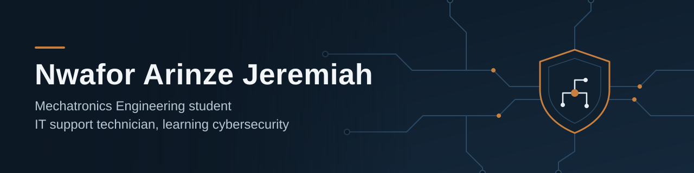

  

## About me

I'm a Mechatronics Engineering student at Enugu State University of Science and Technology (ESUT) and a self-employed computer and printer repair technician with 4 years of hands-on experience. Since 2024 I have been teaching myself cybersecurity, and I am now on a 12-week cybersecurity course with Tech4youth.

I am looking for an internship or entry-level role in IT support or security operations, where I can use my hardware background and keep growing in cybersecurity.

## What I'm working on

- Capturing and inspecting network traffic with Wireshark
- Setting up Suricata to detect suspicious activity and read its alerts
- Practising ethical penetration testing with Metasploit in controlled lab environments
- Getting more comfortable with the Linux command line and shell scripting

## Tools I use

## Background

| Area | Details |
| :--- | :--- |
| Hardware | Diagnosing and repairing laptops, desktops and printers; replacing RAM, storage, screens and power units |
| Systems | Installing and configuring operating systems, drivers and software |
| Security | Network traffic analysis, intrusion detection, vulnerability assessment basics |
| Training | Cybersecurity course, Tech4youth (October 2026, in progress) |
| Education | B.Eng Mechatronics Engineering, ESUT (in progress) |

## Repositories

| Repository | What it is |
| :--- | :--- |
| [LINUX-TASK](https://github.com/Nwafor-Arinze25/LINUX-TASK) | Linux command line and shell exercises |
| [git-practice](https://github.com/Nwafor-Arinze25/git-practice) | Practice with Git and GitHub workflows |

More lab write-ups from my Wireshark, Suricata and Metasploit practice will be added here as I finish them.

## Contact

I'm based in Enugu, Nigeria, and open to internships and entry-level roles. You can reach me through the email on my profile.
